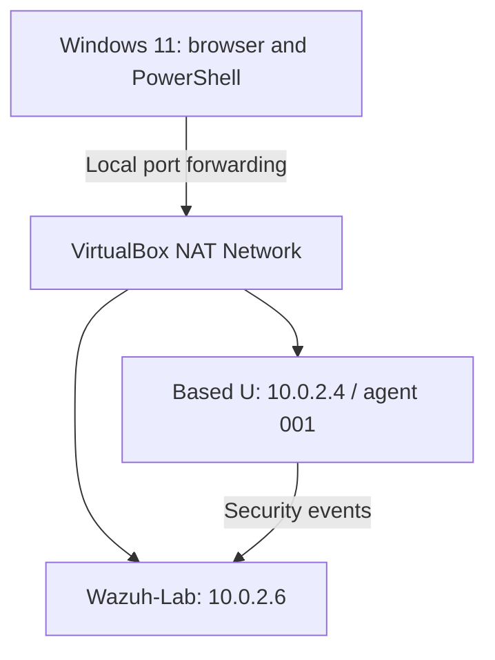
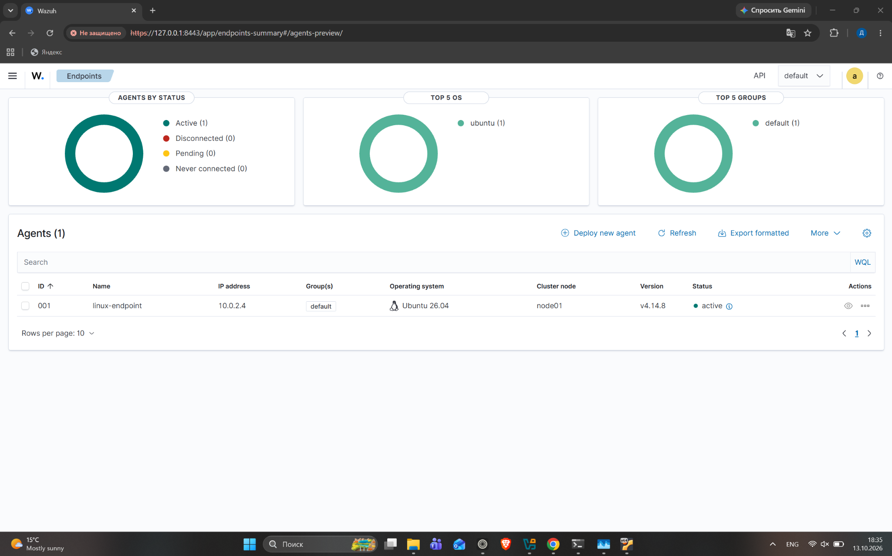

# Wazuh SOC Home Lab

A personal lab for collecting Linux security events and investigating SSH authentication and file changes with Wazuh.

**Author:** Daryn Toleubay · **Wazuh:** 4.14.8 · **Platform:** VirtualBox

## Project overview

I deployed the Wazuh manager, indexer, and dashboard on Ubuntu Server 24.04 and connected a separate Ubuntu 26.04 endpoint. I configured file monitoring, ran controlled tests, and compared SIEM alerts with source logs and file attributes.

This is a guided learning project using built-in Wazuh rules. My work covers deployment, configuration, validation, and analysis. It does not claim development of Wazuh or custom detection rules. All tests were performed on my own lab machines.

## Architecture

| VM | Resources | Role |
| --- | --- | --- |
| Wazuh-Lab | 8 GB RAM, 4 vCPU, 60 GB disk | Central Wazuh components |
| Based U | 1536 MB RAM, 2 vCPU | Monitored Linux endpoint |

The host has 16 GB RAM installed. Dashboard access is through localhost forwarding; this is not a public hosted demo.

## Verified results

| Test | Built-in rule | Evidence |
| --- | --- | --- |
| Failed SSH passwords | 5760 | Endpoint journal and SIEM alerts |
| Successful SSH login | 5715 | Accepted-password record and SIEM alert |
| File creation | 554 | FIM added event |
| File modification | 550 | Text diff, size change, and changed hashes |
| File deletion | 553 | FIM deleted event |

The screenshot shows creation, modification, deletion, and recreation of the same test file on October 16, 2026. These are authorized test operations, not a confirmed attack.

## Investigations and configuration

- [SSH authentication investigation](investigations/01-ssh-authentication.md)
- [File integrity monitoring investigation](investigations/02-file-integrity.md)
- [Lab setup and access](docs/setup.md)
- [Troubleshooting and limitations](docs/troubleshooting.md)
- [FIM configuration fragment](configs/fim-directory.xml)

## What I learned

- Compare original journal records with decoded alert fields.
- Separate failed attempts from successful access and distinguish connections using source ports and process IDs.
- Configure real-time FIM and interpret text differences and hashes.
- Distinguish expected file changes from evidence of an attack.
- Diagnose clock drift with chrony and compare Epoch values with timestamp fields.

## Limitations

The lab uses built-in detections and a small number of manual tests. Who-data attribution and automated response have not been configured. An Ubuntu 22.04 SCA policy was skipped on the Ubuntu 26.04 endpoint. A five-hour discrepancy in the interpretation of a FIM time field remains documented and unresolved; source Epoch values and the alert timestamp were used to validate the tested event time.

MITRE tags do not establish malicious intent, and alert counts are not equivalent to password-attempt counts.

## Next steps

- Test who-data monitoring for user and process attribution.
- Write and validate a custom detection rule.
- Run an independent investigation with a documented decision and supporting evidence.
- Verify clock behavior after VM restart or resume.

## References

- [Wazuh quickstart](https://documentation.wazuh.com/current/quickstart.html)
- [Linux agent deployment](https://documentation.wazuh.com/current/installation-guide/wazuh-agent/wazuh-agent-package-linux.html)
- [FIM configuration](https://documentation.wazuh.com/current/user-manual/reference/ossec-conf/syscheck.html)
- [Chrony command reference](https://chrony-project.org/doc/4.4/chronyc.html)

Only documentation, configuration fragments, and reviewed lab evidence are included. Credentials, agent keys, private certificates, installation archives, and VM images are excluded.
