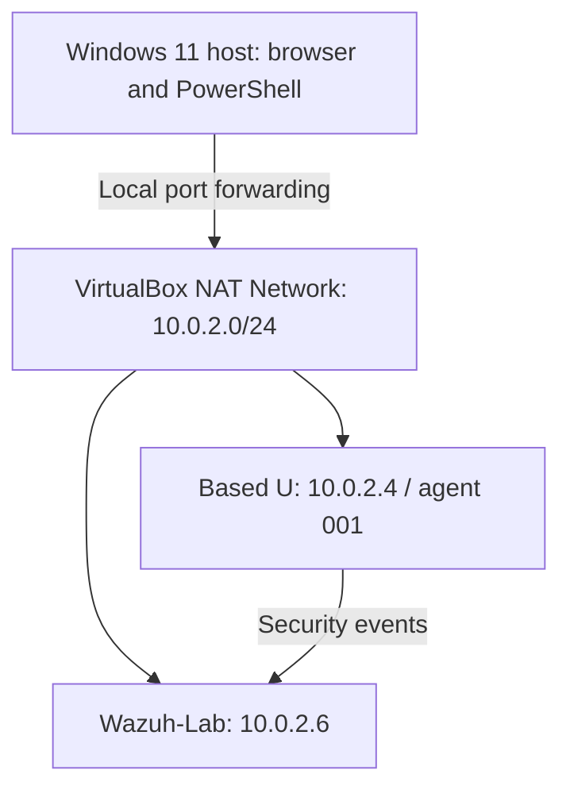

# Lab setup

## Lab architecture



| Machine | Operating system | Resources | Role |
| --- | --- | --- | --- |
| Windows host | Windows 11 | 16 GB RAM installed | Runs VirtualBox; accesses the lab |
| Wazuh-Lab | Ubuntu Server 24.04 LTS | 8 GB RAM, 4 vCPU, 60 GB virtual disk | Manager, indexer, dashboard, and Filebeat |
| Based U | Ubuntu 26.04 | 1536 MB RAM, 2 vCPU, approximately 25 GB root filesystem | Linux endpoint with Wazuh agent 4.14.8 |

The agent is named `linux-endpoint` in Wazuh. Its Linux hostname is `based`.

### Access from Windows

| Purpose | Host address | Guest destination |
| --- | --- | --- |
| Wazuh dashboard | `https://127.0.0.1:8443` | `10.0.2.6:443` |
| Wazuh server SSH | `127.0.0.1:2223` | `10.0.2.6:22` |
| Endpoint SSH | `127.0.0.1:2222` | `10.0.2.4:22` |

Forwarding rules bind to localhost. The Wazuh server address is reserved through VirtualBox DHCP. Both VMs must be running to collect new endpoint events. These localhost addresses work only on the lab host; they are not public demo links.

## Deployment notes

Wazuh 4.14.8 was installed using the official installation assistant on Ubuntu Server 24.04. The Linux endpoint uses the matching 4.14.8 DEB agent package with manager address `10.0.2.6` and agent name `linux-endpoint`.

Use the official documentation to reproduce installation; this document records this lab's configuration, rather than every installation step.

- [Central components installation](https://documentation.wazuh.com/current/quickstart.html)
- [Linux agent installation](https://documentation.wazuh.com/current/installation-guide/wazuh-agent/wazuh-agent-package-linux.html)

## Applying the FIM example

Create `/opt/fim-lab` on the endpoint. Insert the entry from `configs/fim-directory.xml` inside the existing `<syscheck>` block in `/var/ossec/etc/ossec.conf`. It is a fragment, not a replacement configuration. Back up the configuration first.

Validate with `sudo /var/ossec/bin/wazuh-syscheckd -t`. Only after validation succeeds, restart `wazuh-agent` and wait for the initial FIM scan to finish before testing.
## Repeating the FIM test

Run these commands on the **endpoint**, after the directory is configured and the initial scan has completed. Use a new filename for each run to avoid overwriting existing evidence:

```bash
fim_test="/opt/fim-lab/recheck-$(date -u +%Y%m%dT%H%M%SZ).conf"
printf 'status=baseline\n' | sudo tee "$fim_test"
```

Filter the dashboard by agent `001` and the exact path printed in your command. Wait until the added event (rule `554`) appears before continuing.

```bash
printf 'status=base\n' | sudo tee "$fim_test"
```

Wait for rule `550`. Check the diff and the size change from 16 to 12 bytes. Then remove only this newly created test file:

```bash
sudo rm -- "$fim_test"
```

Wait for rule `553`. Run all three steps in the same shell so the variable remains available. Waiting between steps makes each operation observable separately. These commands describe a repeatable test; they do not claim that another run has already been performed.

`report_changes` can include monitored text content in alerts. Use synthetic test data in this directory and do not put passwords or other secrets in it.
