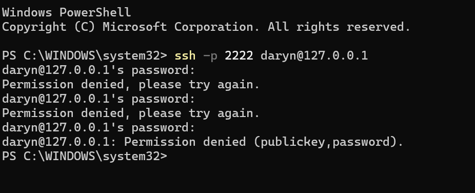
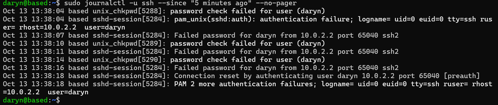
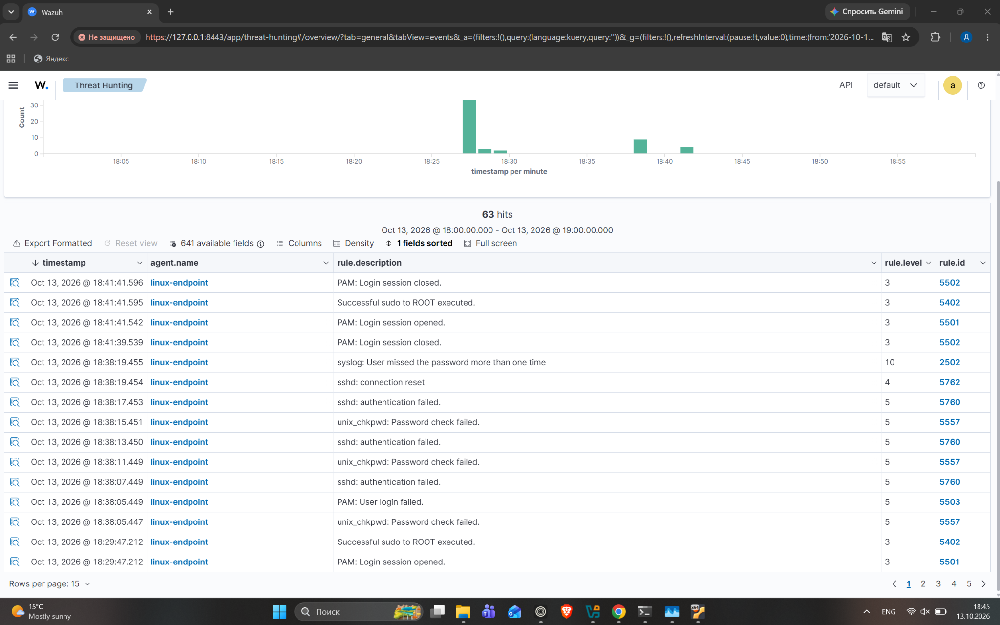
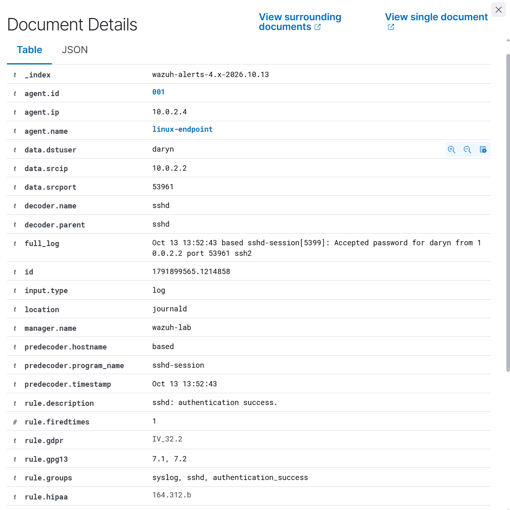
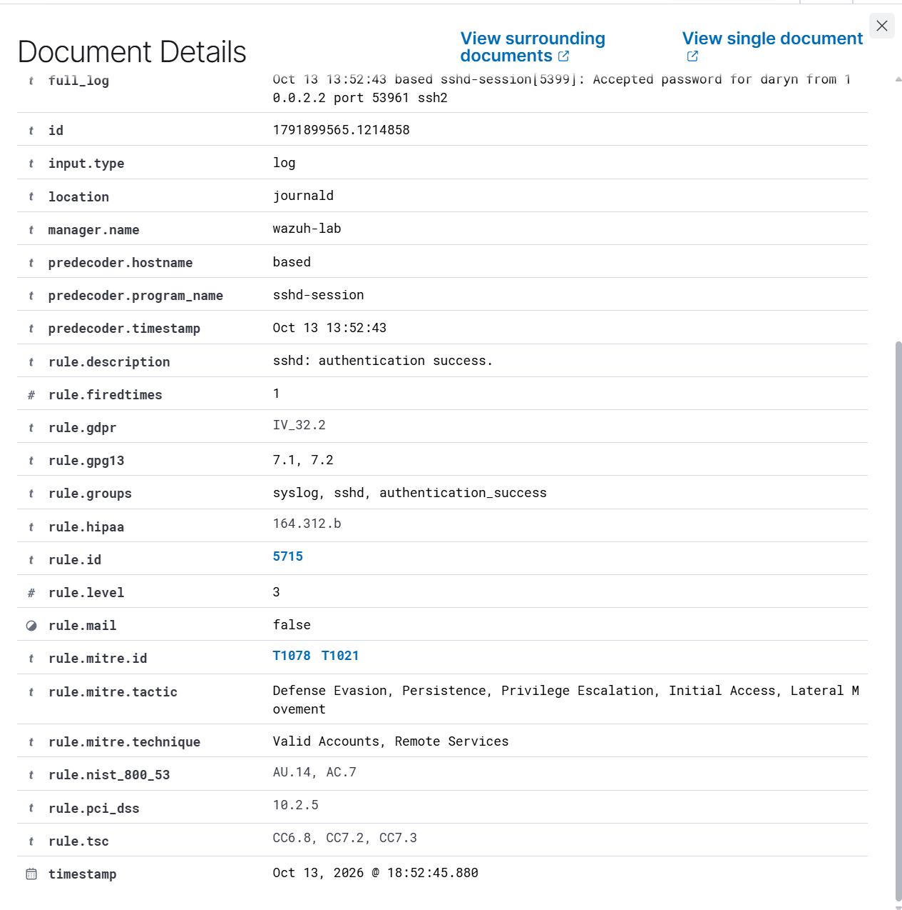

# SSH authentication investigation

On October 13, 2026, I entered three incorrect passwords for the existing user `daryn`. The endpoint journal recorded failures at 13:38:07, 13:38:11, and 13:38:16 in the source journal. All three shared process ID `5284` and source `10.0.2.2:65040`. The connection ended before authentication, and no successful login was present in the reviewed 13:38–13:43 source-journal interval.

In a separate test, one incorrect password was followed by a successful login at 13:52:43 in the source journal. The records shared process ID `5399` and source port `53961`. Wazuh generated rule `5715` for the accepted password.

The endpoint saw source IP `10.0.2.2` through VirtualBox forwarding. It is not an external attacker address. The successful login was a known lab action; it does not show that the earlier failed connection succeeded.

The historical journal lines do not contain a UTC offset. Their times are reported here as recorded, without asserting UTC. The successful-login alert is displayed at 18:52:45.880 in the dashboard, while its embedded source log reads 13:52:43. Given the clock issues encountered in this lab, process IDs, ports, and log content are the primary correlation evidence for these historical records.

Example dashboard search, with the time range set to include the test events:

```text
agent.id:"001" AND rule.groups:"sshd"
```

## Evidence and interpretation

The first connection had three failed passwords and ended before authentication. The second connection had one failed password followed by an accepted password. A successful authentication proves access with valid credentials, but does not by itself establish whether the user is authorized. These tests were performed by the lab owner.

The reviewed source-journal interval from 13:38 to 13:43 contained no accepted SSH login. This conclusion is limited to that interval and the available journal.







The screenshot shows 63 matching documents in a one-hour selection, including sudo and PAM events. This is not a count of 63 failed passwords. The three failed-password attempts in the first test are established from the source journal.





Screenshots of the successful login were captured on October 15; the underlying event occurred on October 13.

## Analyst follow-up in a real environment

Check whether the user expected the login, compare source and session information with normal activity, and examine subsequent privileged actions. A shared NAT address alone is insufficient to identify the person behind a connection. Multiple alerts can describe one password attempt, so alert totals must not be reported as attempt counts.
