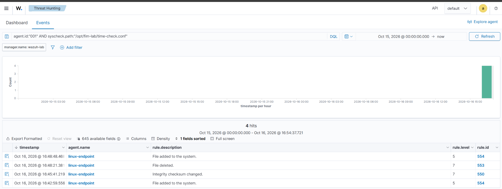
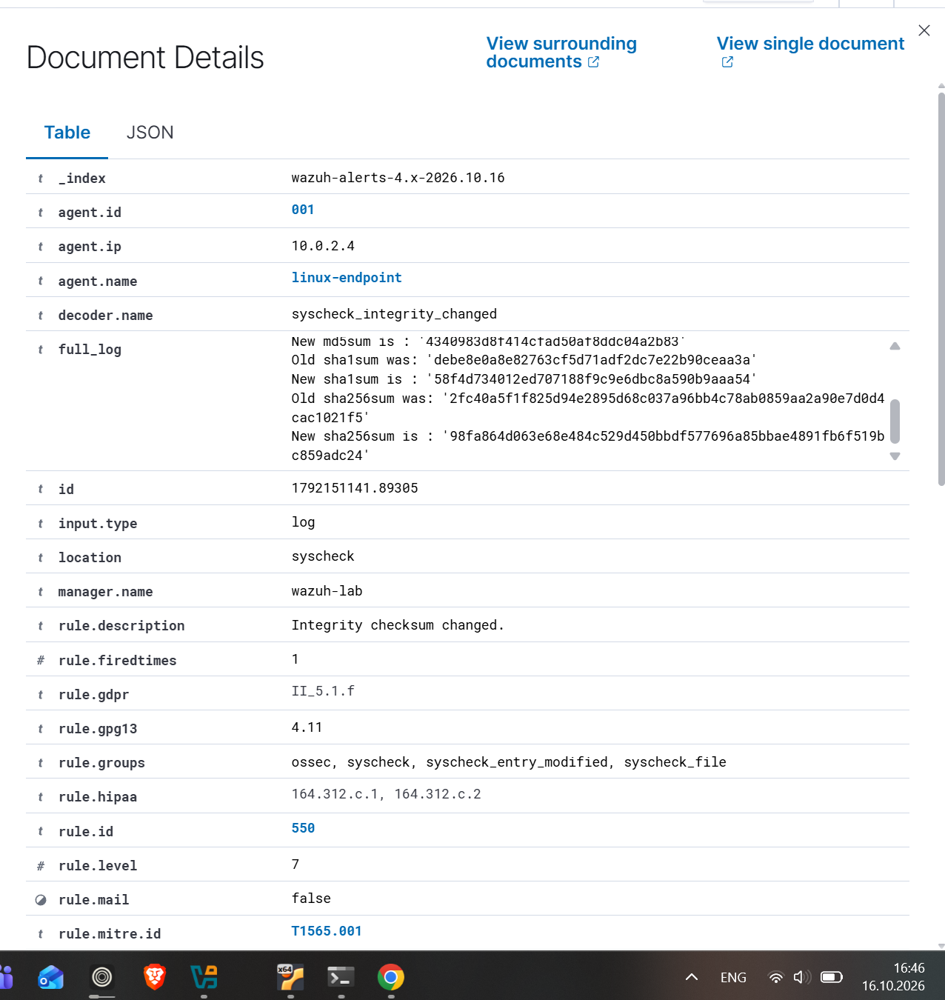
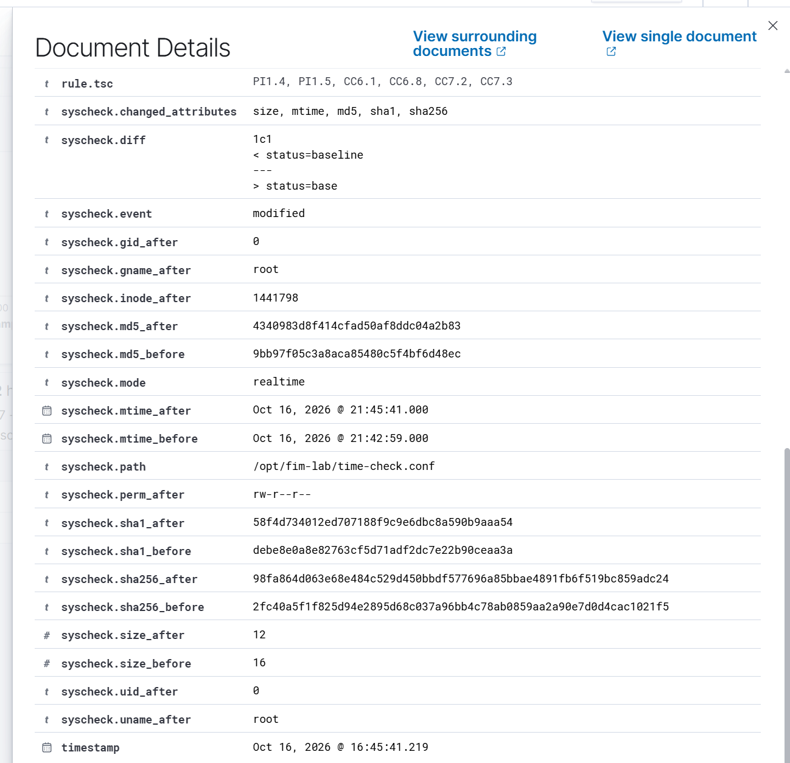

# File integrity monitoring investigation

I added this directory entry inside the existing `<syscheck>` block on the endpoint:

```xml
<directories check_all="yes" realtime="yes" report_changes="yes">/opt/fim-lab</directories>
```

The configuration enables file attribute and checksum checks, real-time monitoring, and text differences for the lab directory. I checked the configuration with `sudo /var/ossec/bin/wazuh-syscheckd -t` before restarting the agent. An initial malformed XML closing tag was corrected before applying the change.

The October 16 test for `/opt/fim-lab/time-check.conf` produced this sequence, shown in dashboard local time (UTC+5):

| Time | Operation | Rule |
| --- | --- | --- |
| 16:42:59.556 | Created | `554` |
| 16:45:41.219 | Modified | `550` |
| 16:48:21.381 | Deleted | `553` |
| 16:48:48.468 | Created again | `554` |

The modification changed `status=baseline` to `status=base`. Wazuh reported a size change from 16 to 12 bytes and different hashes, along with the text diff.

These were authorized test changes. A file change alert establishes that an operation occurred; it does not establish malicious intent. The owner field `root` also does not identify the person or process that made the change. Who-data attribution has not been configured in this lab.

## Evidence







## Conclusion

The configured directory produced the expected built-in alerts for creation, modification, and deletion. Text differences and changed hashes confirmed the content modification. This validates the tested collection and detection path, not malicious intent or automatic incident response.

## Timestamp limitation

The screenshot's `mtime` display is five hours ahead of the alert timestamp. Source Epoch values and the offset-aware alert timestamp were compared; see [troubleshooting](../docs/troubleshooting.md). The screenshots are retained unchanged and this discrepancy is explicitly documented.
