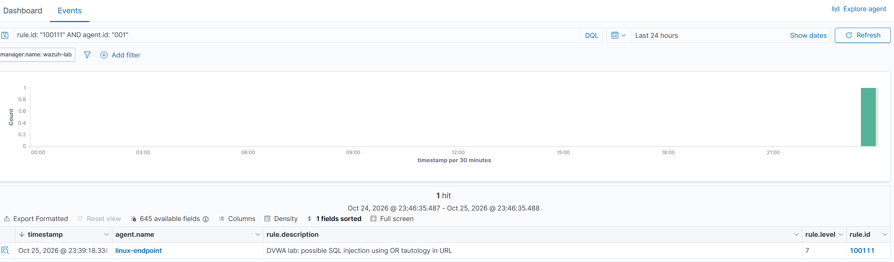

# Web Attack Detection with Wazuh

I connected DVWA Apache access logs to Wazuh and created a custom rule for a specific SQL injection pattern. I compared the built-in rule result with the custom detection, confirmed a live alert, and documented a missed variant.

**Author:** Daryn Toleubay  
**Lab date:** 25 October 2026  
**Status:** Completed first lab iteration; narrow detection coverage.

## Results

| Check | Observed result |
|---|---|
| Encoded `1' OR '1'='1`, before the custom SQLi rule | Rule 31100, level 0 in logtest; no SQLi alert |
| Same log sample with the custom rule | Rule 100111, level 7 in logtest |
| New browser SQLi request after deployment | Rule 100111 received from agent 001 and visible in Dashboard |
| Normal id=1 and synthetic id=2 | No rule 100111 match |
| Synthetic SQLi string only in Referer | No rule 100111 match |
| Synthetic alternative `'2'='2'` | Missed; rule 31100, level 0 |

The browser returned five DVWA test users for the injection and one user for normal id=1. The application output demonstrates the lab effect. The SIEM rule detects the request pattern; it does not independently prove successful exploitation.

## Lab architecture

Windows browser accesses DVWA through an SSH tunnel to Based U. Apache writes logs into a directory mounted from the Ubuntu host. Wazuh Agent reads that file and sends events to the separate Wazuh server.

| Component | Lab configuration |
|---|---|
| Wazuh server | Ubuntu VM, 8 GiB assigned RAM; Manager logtest reports Wazuh 4.14.8 |
| Monitored endpoint | Ubuntu VM, about 1.4 GiB visible RAM, agent linux-endpoint / 001 |
| Application | Official DVWA container and MariaDB 10; DVWA security Low |
| HTTP exposure | 127.0.0.1:4280 on the endpoint; Windows access via SSH forwarding |
| Collected source | /var/log/dvwa/access.log; Apache combined format |

Screenshots show private lab addresses. The recorded source 172.18.0.1 is the Docker gateway in this access arrangement, not the original Windows client IP. Lab addresses may change with DHCP.

## Repository contents

- [Setup and reproduction](docs/setup.md)
- [SQL injection investigation](investigations/sql-injection.md)
- [Observed test results and limitations](tests/results.md)
- [Screenshot index](docs/evidence.md)
- [Wazuh rules](rules/dvwa_lab_rules.xml)
- [Agent collection snippet](configs/agent-localfile.xml)
- [Compose log mount](configs/compose.override.yaml)
- [Saved and synthetic log samples](tests/log-samples.log)
- [Troubleshooting notes](docs/troubleshooting.md)

## Scope

Rule 100110 is a diagnostic delivery marker, not an attack rule. Rule 100111 is a learning rule for one OR tautology pattern on one DVWA path. It is not a general SQLi detector, WAF, blocking mechanism, or production-ready ruleset. This small selected sample does not establish production precision, recall or false-positive rate. See the documented miss before reusing the rule.

I built and tested the lab with guidance, using official documentation and AI assistance for commands, troubleshooting, rule development and documentation. Screenshots are from my lab.

## References

- [Official DVWA repository](https://github.com/digininja/DVWA)
- [Wazuh custom rules](https://documentation.wazuh.com/current/user-manual/ruleset/rules/custom.html)
- [Wazuh rule syntax](https://documentation.wazuh.com/current/user-manual/ruleset/ruleset-xml-syntax/rules.html)
- [Wazuh localfile configuration](https://documentation.wazuh.com/current/user-manual/reference/ossec-conf/localfile.html)
- [Wazuh logtest](https://documentation.wazuh.com/current/user-manual/ruleset/testing.html)

DVWA is deliberately vulnerable. Reproduce this lab only in your own isolated environment; keep its HTTP port bound to loopback.
